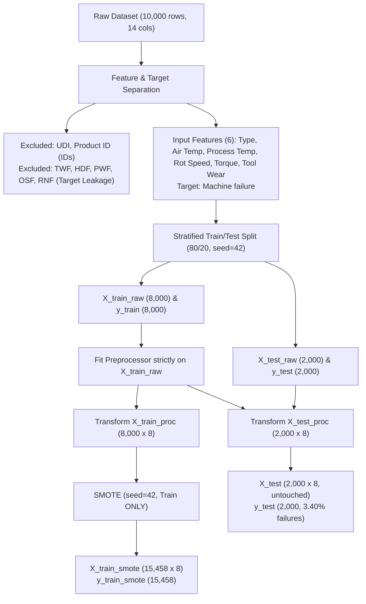

# Phase 2 Walkthrough: Data Preprocessing & Train/Test Pipeline

## Overview
In **Phase 2**, we built a modular, leakage-free data preprocessing and train/test pipeline for the AI4I 2020 Predictive Maintenance Dataset.

---

## 1. Pipeline Architecture & Design Decisions

### Key Design Decisions:
1. **Target Leakage Prevention**: Excluded failure mode flags (`TWF`, `HDF`, `PWF`, `OSF`, `RNF`) from the primary machine failure model. These flags are failure consequence annotations rather than precursor operating signals.
2. **Metadata Elimination**: Excluded `UDI` and `Product ID`.
3. **Engineering Unit Preservation**: Numerical features (`Air temperature [K]`, `Process temperature [K]`, `Rotational speed [rpm]`, `Torque [Nm]`, `Tool wear [min]`) are passed through without scaling to maintain physical interpretability for tree-based models.
4. **Leakage-Safe Preprocessor**: `ColumnTransformer` with `OneHotEncoder` fitted **strictly** on the training split (`X_train`).
5. **Isolated SMOTE**: Applied **strictly** to the training data. The test set remains untouched at its natural 3.40% failure prevalence.

---

## 2. Quantitative Summary & Exact Values

| Metric / Parameter | Value |
| :--- | :--- |
| **Raw Dataset Shape** | `(10000, 14)` |
| **Input Features (Raw, 6)** | `Type`, `Air temperature [K]`, `Process temperature [K]`, `Rotational speed [rpm]`, `Torque [Nm]`, `Tool wear [min]` |
| **Encoded Features (8)** | `Type_H`, `Type_L`, `Type_M`, `Air temperature [K]`, `Process temperature [K]`, `Rotational speed [rpm]`, `Torque [Nm]`, `Tool wear [min]` |
| **Target Variable** | `Machine failure` |
| **Random State** | `42` |
| **Train / Test Split Ratio** | `80% / 20%` (Stratified) |
| **X_train Shape** | `(8000, 8)` |
| **y_train Shape** | `(8000, 1)` |
| **X_test Shape** | `(2000, 8)` |
| **y_test Shape** | `(2000, 1)` |
| **Original Train Class Distribution** | `7,729` Healthy (96.61%) / `271` Failures (3.39%) |
| **Original Test Class Distribution** | `1,932` Healthy (96.60%) / `68` Failures (3.40%) |
| **Post-SMOTE X_train Shape** | `(15458, 8)` |
| **Post-SMOTE y_train Shape** | `(15458, 1)` |
| **Post-SMOTE Train Class Distribution** | `7,729` Healthy (50.00%) / `7,729` Failures (50.00%) |

---

## 3. Validation Results

All 10 automated validation tests in [`tests/test_preprocessing.py`](file:///c:/Users/Sanjay.%20RK/.gemini/antigravity-ide/scratch/Manufacturing_Analytics/tests/test_preprocessing.py) passed with 100% integrity:

- [x] **Check 1**: No missing values across all processed datasets.
- [x] **Check 2**: Zero duplicate rows introduced.
- [x] **Check 3**: Identifiers (`UDI`, `Product ID`) strictly excluded.
- [x] **Check 4**: Target (`Machine failure`) cleanly separated.
- [x] **Check 5**: Stratified train/test split preserved class proportions (Train: 3.39%, Test: 3.40%).
- [x] **Check 6**: Test data untouched by SMOTE (Exact shape: 2,000 x 8).
- [x] **Check 7**: No target-derived failure flags (`TWF`, `HDF`, `PWF`, `OSF`, `RNF`) used as input features.
- [x] **Check 8**: Feature names correctly tracked across all splits.
- [x] **Check 9**: Preprocessor transforms single-machine inputs consistently while preserving physical units.
- [x] **Check 10**: Zero data leakage verified between train and test sets.

---

## 4. Artifacts Created & Updated

1. **Code Modules & Notebooks**:
   - [`src/preprocessing.py`](file:///c:/Users/Sanjay.%20RK/.gemini/antigravity-ide/scratch/Manufacturing_Analytics/src/preprocessing.py) (Reusable preprocessing pipeline and API)
   - [`notebooks/03_preprocessing.ipynb`](file:///c:/Users/Sanjay.%20RK/.gemini/antigravity-ide/scratch/Manufacturing_Analytics/notebooks/03_preprocessing.ipynb) (Interactive walkthrough notebook)
   - [`tests/test_preprocessing.py`](file:///c:/Users/Sanjay.%20RK/.gemini/antigravity-ide/scratch/Manufacturing_Analytics/tests/test_preprocessing.py) (Automated test suite)
   - [`config.py`](file:///c:/Users/Sanjay.%20RK/.gemini/antigravity-ide/scratch/Manufacturing_Analytics/config.py) (Updated with feature and artifact paths)

2. **Processed Datasets**:
   - [`data/processed/X_train.csv`](file:///c:/Users/Sanjay.%20RK/.gemini/antigravity-ide/scratch/Manufacturing_Analytics/data/processed/X_train.csv) `(8000, 8)`
   - [`data/processed/X_test.csv`](file:///c:/Users/Sanjay.%20RK/.gemini/antigravity-ide/scratch/Manufacturing_Analytics/data/processed/X_test.csv) `(2000, 8)`
   - [`data/processed/y_train.csv`](file:///c:/Users/Sanjay.%20RK/.gemini/antigravity-ide/scratch/Manufacturing_Analytics/data/processed/y_train.csv) `(8000, 1)`
   - [`data/processed/y_test.csv`](file:///c:/Users/Sanjay.%20RK/.gemini/antigravity-ide/scratch/Manufacturing_Analytics/data/processed/y_test.csv) `(2000, 1)`
   - [`data/processed/X_train_smote.csv`](file:///c:/Users/Sanjay.%20RK/.gemini/antigravity-ide/scratch/Manufacturing_Analytics/data/processed/X_train_smote.csv) `(15458, 8)`
   - [`data/processed/y_train_smote.csv`](file:///c:/Users/Sanjay.%20RK/.gemini/antigravity-ide/scratch/Manufacturing_Analytics/data/processed/y_train_smote.csv) `(15458, 1)`

3. **Models & Metrics Artifacts**:
   - [`models/preprocessor.joblib`](file:///c:/Users/Sanjay.%20RK/.gemini/antigravity-ide/scratch/Manufacturing_Analytics/models/preprocessor.joblib) (Fitted pipeline transformer)
   - [`outputs/metrics/preprocessing_summary.json`](file:///c:/Users/Sanjay.%20RK/.gemini/antigravity-ide/scratch/Manufacturing_Analytics/outputs/metrics/preprocessing_summary.json) (Metadata summary)
   - [`outputs/tables/preprocessing_summary.csv`](file:///c:/Users/Sanjay.%20RK/.gemini/antigravity-ide/scratch/Manufacturing_Analytics/outputs/tables/preprocessing_summary.csv) (Summary table)
